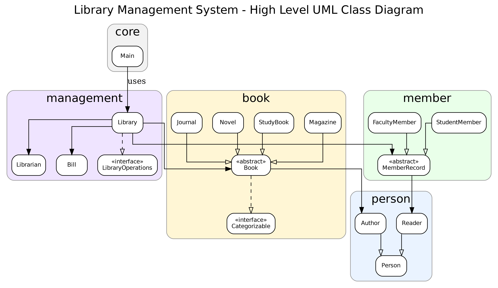

# Kütüphane Yönetim Sistemi

Java ile geliştirilmiş, konsol üzerinden kullanılan bir kütüphane yönetim uygulaması. Workintech Java OOP çalışması kapsamında kitap, yazar, üye ve kütüphaneci ilişkilerini nesne yönelimli bir tasarımla modeller.

Ödevin gereksinimleri [ASSIGNMENT.md](ASSIGNMENT.md) dosyasında yer alır.

## Özellikler

- Üye kaydı, üye girişi ve kütüphaneci yönetim paneli.
- Kitap ekleme, silme; fiyat ve baskı bilgilerini güncelleme.
- ID, kitap adı veya yazar adına göre arama; yazara ve kitap türüne göre listeleme.
- Roman, akademik yayın, ders kitabı ve dergi türleri; birden fazla yazar desteği.
- Kitap ödünç alma, iade etme ve üyenin üzerindeki kitapları görüntüleme.
- Öğrenciler için 5, akademisyenler için 10 kitap ödünç alma limiti.
- Ödünç alma sırasında 10 TL depozito faturası, iadede depozito iade faturası.
- 14 günü aşan ödünç işlemlerinde geciken her gün için 5 TL ceza faturası.

## Kurulum ve çalıştırma

JDK 17 veya üzeri gereklidir. Proje harici bağımlılık, Maven veya Gradle kullanmaz.

### IntelliJ IDEA

1. Projeyi IntelliJ IDEA ile açın.
2. Project SDK olarak JDK 17 veya üzerini seçin.
3. Gerekirse `src` klasörünü **Sources Root** olarak işaretleyin.
4. `src/com/library/core/Main.java` dosyasındaki `main` metodunu çalıştırın.

### Terminal (PowerShell)

Projenin kök dizininde aşağıdaki komutları çalıştırın:

```powershell
$sources = Get-ChildItem -Path src -Recurse -Filter *.java | Select-Object -ExpandProperty FullName
javac -encoding UTF-8 -d out $sources
java -cp out com.library.core.Main
```

## Örnek kullanım

Uygulama örnek kitaplar ve bir öğrenci üye ile başlar.

| Giriş türü | Bilgiler |
| --- | --- |
| Kütüphaneci | Kullanıcı adı: `admin`, şifre: `123456` |
| Örnek üye | Üye ID: `STU-1` |
| Yeni üye | Ana menüden **Yeni Üye Kaydı** seçeneğini kullanın; oluşturulan ID ile giriş yapın. |

Örnek üyenin üzerinde başlangıçta beş kitap bulunur. Ödünç alma işlemini denemek için önce bu kitaplardan birini iade edebilir veya yeni bir üye oluşturabilirsiniz.

Veriler bellekte tutulur; uygulama kapatıldığında değişiklikler kaybolur. Giriş bilgileri eğitim amaçlı örnek verilerdir. Depozito ve ceza işlemleri fatura kaydı oluşturur; gerçek ödeme yapılmaz.

## Proje yapısı ve OOP tasarımı

```text
src/com/library/
├── core/        # Uygulamanın giriş noktası ve konsol menüleri
├── book/        # Kitap türleri, kategoriler ve kitap durumları
├── person/      # Kişi, yazar ve okuyucu modelleri
├── member/      # Üyelik kayıtları, öğrenci ve akademisyen üyeler
└── management/  # Kütüphane, kütüphaneci ve fatura işlemleri
```

`Book`, `Person` ve `MemberRecord` soyut sınıfları kalıtım yapısını kurar. Kitaplar `Categorizable` arayüzünü uygular; farklı kitap türleri ortak `Book` tipi üzerinden işlenir. Üyelik kayıtları okuyucu nesnesini içerir. `List` envanter ve faturaları, `Set` tekrarsız yazar ve ödünç kitap kayıtlarını, `Map` ise ID eşleştirmelerini ve kitabın hangi üyede olduğunu tutar.

## Sınıf diyagramı


